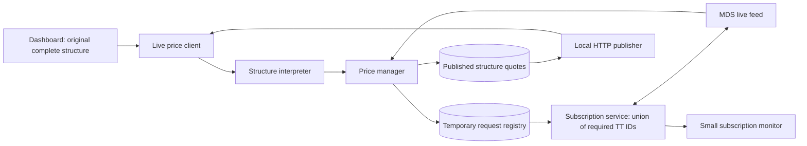

# Structure breakdown lab

A simple table for multiple complete structures: best bid, best ask, average
and status. Prices come only from the shared live manager; reconstruction
panels have been removed from the dashboard.
This remains an isolated prototype: production dashboards, port 8060, the master
database and `market_data/` are unchanged.

From the project root:

```powershell
.\.venv\Scripts\python.exe -B -m structure_lab.manager_server
```

In a second terminal:

```powershell
.\.venv\Scripts\python.exe -B -m structure_lab.dashboard
```

Open **http://127.0.0.1:8070**. Restart the lab process after code changes.
The tiny subscription monitor is **http://127.0.0.1:8071**. Both bind to localhost.
For another dashboard process, use `python -B -m structure_lab.dashboard --port 8072`;
both pages share the manager on 8071. Each dashboard process has its own owner ID.

## Shared demand and publication flow



1. The dashboard sends a string such as `CL X27 1MDF`; it does not send monthly
   legs, fetch authentication tokens, select TT IDs, or synthesize live prices.
2. The interpreter preserves the original expression and resolves quoted flies,
   spreads and boxes using the saved catalogue. It rejects outright live requests.
3. The manager saves the expression, component requirements and a **30-minute
   lease** to `structure_lab/runtime/structure_requests.sqlite3`. This is separate
   from the master database and the earlier lab observation cache.
4. The subscription service reads active requirements and subscribes the union
   of required IDs. Shared IDs are subscribed once. Alternatives are limited to
   months involved in the named request, including intermediate months whose
   exposure cancels when components are combined.
5. The manager resolves best bid and ask independently, computes their midpoint,
   and publishes the result under the original expression and its request ID.
   Per-component quotes and each best-side recipe are also available.
6. Dashboards fetch published results; reads do not run the optimizer or contact
   MDS. The helper renews its lease every 15 seconds while the page polls prices.
   Stop releases only that dashboard's request. If a dashboard disappears, its
   lease expires; IDs still needed elsewhere remain required.

The manager reuses the existing streamer sessions. New IDs are subscribed on
those sessions; unused IDs are unsubscribed. Removing part of a subscription
batch replaces only that batch, keeping the connection and other batches live.
Polling and heartbeats never reconnect. Idle sessions remain available for future
requests, and shutdown disconnects them. A new connection is created only when
the required authentication group has no existing session; the SDK also handles
recovery from actual network disconnections.
Publication runs in the manager's background worker, normally once per second
plus calculation time. Results older than 10 seconds are withheld, not shown as
current. The manager monitor lists active original requests, lease remaining,
required IDs, accepted subscriptions and IDs with received data. Accepted does
not guarantee that a contract has current bid/ask prices.

## Calling from another test dashboard

```python
from structure_lab.live_price_client import LivePriceClient

live = LivePriceClient(owner="my-test-dashboard")
requests = live.register(["CL X27 1MDF", "CL Z27 1MF"])
ids = [request["request_id"] for request in requests]
live.renew(ids)       # Repeat about every 15 seconds while these are needed.
quotes = live.quotes(ids)
# Each result retains expression; result["quote"]["overall"] has bid, ask, mid.
# quote can initially be None while subscriptions/snapshots are pending.
for request_id in ids:
    live.release(request_id)  # When no longer needed.
```

HTTP endpoints on 8071: `POST /requests` (owner, structures, optional ttl),
`POST /requests/heartbeat` (owner, request_ids), `GET /quotes/<request_id>`,
`POST /quotes` (request_ids), `DELETE /requests/<request_id>?owner=...`, and
`GET /status`. Leases default to 1800 seconds (30 minutes), with an optional range
of 30–1800 seconds. Registration is idempotent per
owner and original expression. A batch is validated before any request is saved.
The database stores temporary requirements and latest publications, never tokens
or raw tick history. On startup old publications are cleared; unexpired leases
can resume. There is one manager process per temporary registry.

## Using the watchlist

Enter one complete structure per line, for example:

```text
CL X27 1MDF
CO X27 3MS
CL X27 1MDF - CO X27 3MS
```

Click **Connect / update** to register all lines with the manager. The table
shows the original structure, best bid, best ask, average and status. Duplicate
lines are combined. Up to 64 structures can be watched together. Updating the
list releases removed requests; **Disconnect all** releases the whole watchlist.
Each browser session has its own owner ID and stores its watchlist across refreshes.

The dashboard no longer interprets structures locally or displays SEAC, minute,
component or alternative recipes. Parsing and live reconstruction happen in the
manager. One batch fetch updates all rows every second; the dashboard requests
compact results without component books or calculation recipes. Missing, stale
or unavailable prices remain blank. The manager still retains the detailed
results for other API consumers using the default full response.

Average is (best bid + best ask) / 2 and requires both sides. Before optimization,
the manager prices complete recipes using quoted named components, calendar
spreads and previously successful recipes repriced against current fresh books.
Valid available prices remain visible when optimization times out or fails.
Bid and ask can be available independently; missing sides remain blank, with an
explicit reason. No stale price or incomplete component sum is presented as a
current complete-structure price.

The optimizer normally compares combinations of up to three instruments. When a
valid fallback needs more, that request's limit expands to include that recipe.
Previously successful recipes retain only TT IDs and weights, never old prices.
Prices are indicative; when optimality is unconfirmed, the status says so. Candidate selection uses
only saved IDs within the requested named components' months, with no outrights.

Failed subscriptions are retried at 15-second intervals on existing sessions;
unacknowledged subscription batches are replaced after 30 seconds. Network
reconnection remains the SDK's responsibility. Per-request calculation or
publication failures are isolated so other rows can continue updating.

The subscription monitor on 8071 still shows original requests and the names,
TT IDs, acceptance and receipt status of the required underlying quotes.

## Notation

| Example | Meaning |
|---|---|
| `CL X27 1MS` | Nov-Dec 2027 spread |
| `CL X27 3MS` | Nov 2027-Feb 2028 spread |
| `CL X27 1MF` | Butterfly: 1:-2:1 |
| `CL X27 1MDF` | Double fly: 1:-3:3:-1; `1DF` also accepted |
| `CL X27 1MDDF` | Difference of double flies: 1:-4:6:-4:1; `1DDF` also accepted |
| `2 * CL X27 1MF` | Two flies |
| `CL-CO X27 1MS` | CL-CO box exposure |
| `CL X27 OUT` | One settlement contract; minute/live panels report unsupported |

Compact forms such as `CL X271MF` work too. Use `+` or `-` between named
components. Products: CL, CO, G, HO, NG, RB, CL-CO. BRN/LCO normalize to CO;
GO/LGO to G. For minute storage CO becomes LCO and G becomes LGO, with the
existing one-digit source-year convention.

## Files

- `dashboard.py`: multi-structure watchlist with compact batched price polling; no local reconstruction.
- `live_price_client.py`: dashboard helper; whole requests, heartbeats and published quotes.
- `structure_interpreter.py`: whole expression → live requirements and saved candidate IDs.
- `request_store.py`: temporary SQLite requests, leases, required IDs and latest publications.
- `subscription_service.py`: deduplicates demand across active requests and reconciles the feed.
- `price_manager.py`: coordinates requests and calculates/publishes per-structure prices.
- `manager_server.py`: shared publisher on 8071 and small subscription monitor.
- `live_feed.py`: independent lab authentication, subscription lifecycle and in-memory books.
- `resolvers/best_bid_ask.py`: lab-local optimizer snapshot; production modules are not imported.
- `interpretation.py`: prepares all three source-specific recipes, without I/O.
- `expression.py`: named parser and normalized monthly exposure.
- `catalogue.py`: read-only saved TT-ID lookup; no network catalogue requests.
- `resolvers/minute.py`: stored-spread recipe builder.
- `resolvers/live.py`: quoted-component recipe builder.
- `resolvers/seac.py`, `data_client.py`, `sources.py`, `live_manager.py`: retained
  programmatic data adapters from the earlier prototype; the page does not call
  them to fetch data, connect feeds or write runtime records.
- `tests/test_lab.py`: offline tests and disposable fixture database checks.

The existing SEAC, minute and live fetching helpers remain available for future
experiments, but the dashboard does not use them for historical reads or recording.
There are no source switches, date controls or charts. Production files are unchanged.

## Tests

```powershell
.\.venv\Scripts\python.exe -B -m unittest structure_lab.tests.test_lab structure_lab.tests.test_live_feed structure_lab.tests.test_demand_manager
```

Tests check parser aliases, MDF/MDDF expansions, each recipe and dashboard
callbacks. The non-subscribing UI tests explicitly reject network calls and database access.
Feed tests use mocked authentication/SDKs, test generation-safe shutdown and
verify component and composite prices.
Demand-manager tests check whole-expression publication, shared subscriptions,
owner-specific release, heartbeat expiry, stale-result suppression and atomic
batch validation. These use fake feeds, not the live market connection.
Historical-adapter tests use only disposable fixture databases.

